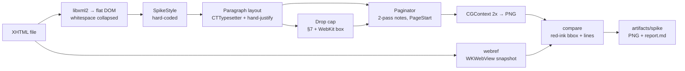

# P0 spike: drop caps and in-page footnotes on CoreText

## Overview

This spike de-risks the two hardest parts of the engine before anything else is built:

- `initial-letter` drop caps;
- in-page footnotes with page breaking.

It also proves that a page can be laid out from a saved page start in a fresh process. That property is what makes reopening a book cost one page of layout, the number-one goal in [project-brief](../../docs/project-brief.md).

The output is PNGs, side-by-side comparisons against WebKit, and a `report.md` in `artifacts/spike/`. The spike ends at **G1**: the owner looks at the images and gives the final verdict.

The code is real, not throwaway. It is the seed of `CoReaderEngine`. Two parts are deliberately temporary:

- a hard-coded style table (`SpikeStyle`) instead of CSS, which arrives in P2;
- a CLI that reads extracted XHTML files instead of the ZIP, which arrives in P1.

Both are marked `ponytail:` in code.

## Inputs (verified research)

- [research/coretext-layout.md](research/coretext-layout.md) — a verified CoreText recipe:
  - drop-cap size formula from §7.5.3;
  - page layout takes 2.2 ms with `CTLineCreateJustifiedLine`, and about 0.23 ms for justification by hand;
  - CoreText never hyphenates;
  - the `WithOffset` variant does not narrow lines.
- [research/webkit-reference.md](research/webkit-reference.md) — a verified windowless `WKWebView` CLI:
  - **only `-webkit-initial-letter` works**;
  - the cap's top aligns on cap-height within 0.03 px;
  - text lines start at the cap's *advance* box edge, and the side bearing is not kerned.
- Spec: `docs/refs/epub/spec/css-inline-3.md` §7. Profile: §5, §6 and §8 of [coreader-epub-profile.md](../../docs/coreader-epub-profile.md).

## Decisions taken for the spike

| # | Decision | Source |
|---|---|---|
| S1 | Drop caps align on the font's cap-height metric, like the undiacritised letter. Diacritic ink overflows upward and is never clipped or pushed. Glitches are listed only. | Owner, 2026-10-11 |
| S2 | Justification is done by hand, widening only U+0020. Never stretch last lines or under-full lines. | research/coretext-layout §4 |
| S3 | One `CTTypesetter` per paragraph; per-line widths come from `CTTypesetterSuggestLineBreak(width)`. Offsets are UTF-16 **relative to the block, including the first letter**. | research §2, §4; red team |
| S4 | **The drop-cap box follows WebKit**: the exclusion is the cap's advance width plus `margin-right`. The left side bearing is kept (no kerning). The exclusion covers every line the cap's ink touches, carries into the next block on the same page, and is dropped at a page break. | Owner, 2026-10-11 (red-team adjudication); research/webkit-reference §1 |
| S5 | WebKit reference: `-webkit-initial-letter`, a red cap, 2x snapshots, and a hard fail if the image is not 1200 px wide. Comparison is ink to ink, **relative to line 1's top**, with loose tolerances: ≤ 1 CSS px for cap top/bottom on flat letters, ≤ 2 px for the line start x. | research; owner: "không cần quá chặt" (no need to be too strict) |
| S6 | No hyphenation in v1 (owner decision, 2026-10-11). `hyphens` is parsed and ignored. | Owner |
| S7 | Page 600×900 pt, 40 pt margins, body **Times New Roman 18 pt** (neither book sets a body family), rendered at 2x. Book faces are mapped explicitly from CSS family to file and used only where `book.css` uses them: headings and the Tarif cap. A missing face is a hard error. Every glyph run is drawn with its `CTRun`'s own font, so fallback glyphs such as `⦾` render. | red team |
| S8 | `artifacts/` and `.build/` are gitignored. Book-derived PNGs are never committed. `scripts/spike.sh` regenerates everything. | AGENTS.md |
| S9 | Whitespace is collapsed per CSS `white-space: normal`. `epub:type` is read with `xmlGetNsProp` in the OPS namespace. Sibling selectors skip non-element nodes. | red team (fixtures contain hard newlines in notes) |
| S10 | Widows/orphans, the "heading never ends a page" rule and `hr` at page edges are **deferred to P3**. P0 implements only the footnote and drop-cap page rules. | red team (scope) |

## Phases

| # | Phase | Effort | Depends | Status |
|---|---|---|---|---|
| 1 | [Package, XHTML reader, paragraph layout](phase-01-package-and-paragraph-layout.md) | 2d | — | Pending |
| 2 | [Drop caps and WebKit reference comparison](phase-02-drop-caps-and-webkit-reference.md) | 2d | 1 | Pending |
| 3 | [Footnote pagination and resumable page starts](phase-03-footnote-pagination-and-resume.md) | 3d | 1, 2 | Pending |
| 4 | [Real chapters, timing, report, gate G1](phase-04-real-chapters-report-g1.md) | 1d | 2, 3 | Pending |

## Success criteria (G1 package)

- [ ] `swift build -c release` passes, and `CoReaderEngine` imports no AppKit (grep check).
- [ ] Drop-cap matrix with side-by-side PNGs (ours | WebKit):
  - letters M, Đ, Ừ and Ặ; N = 2, 3 and 5; `3 2` with M; a short paragraph; a leading `“M`;
  - **the Tarif cap of bien-than c04 and the N=2 cap of nguoi-moi-den c03**.
  
  `compare` passes S5's tolerances on flat letters and lists the rest.
- [ ] Footnote cases render as specified, and `paginate --check` passes on every one:
  - `footnote-push`;
  - `footnote-split`;
  - `footnote-edge`;
  - bien-than c04 (**4 notes**);
  - nguoi-moi-den c03 (6 notes).
  
  Note counts are read from the XHTML, never hard-coded.
- [ ] Resume is proven independently of the paginator:
  - (a) the concatenated body lines of all pages equal a continuous tall-column layout of the chapter;
  - (b) `verify-resume` decodes each `PageStart` from `pages.json` **in a separate process** and reproduces the page exactly.
- [ ] `bench` reports per chapter:
  - `reopenMs`: the median of 5 fresh processes, cold, covering parse + style + fonts + `layoutPage(from: mid)` + bitmap;
  - `pageMeanMs`: warm.
  
  The numbers are for reference only. There is no baseline yet, so there are no targets and no pass/fail.
- [ ] `scripts/spike.sh` regenerates `artifacts/spike/` from scratch. The synthetic parts run even without `Fixtures/private/`.
- [ ] `report.md` contains deltas, timings, known glitches (diacritics and any others), the statement that **footnote pages have no WebKit reference** (they are judged by eye plus `--check`), and the open questions for G1.
- [ ] **G1: the owner's verdict on the images.** Stop; P1 does not start without it.

## Out of scope

- The ZIP, OPF and nav (P1).
- The CSS parser and cascade (P2).
- Images, widows/orphans, headings at the bottom of a page, and `break-before` (P3). Hyphenation is not in v1.
- Backlink hiding: the profile fixtures contain no backlinks. It moves to P1/P2.
- The app (P4).
- CFI and the cache files (P5).

## Risks

| Risk | Likelihood | Mitigation |
|---|---|---|
| WebKit rounding (glyph pixel snapping) differs from ours | High | Loose tolerance (S5), measured relative to line 1, ink to ink; the owner judges by eye |
| A decorative font has a wrong OS/2 cap-height | Medium | Reported as a known glitch (S1). The fallback (ink top of "H") becomes an open question. |
| Resume breaks because of hidden state | Medium | `PageStart` carries every pending note explicitly. First-ref positions are fixed at parse time. Independent checks (a) and (b). |
| Fixtures never exercise the footnote edge paths (all real notes are ≤ 368 chars, 1 ref each) | Certain | Synthetic `footnote-edge.xhtml` |
| Profile §8 promises "hyphenation by lang" | — | Resolved: hyphenation is out of v1, and §8 was updated (owner, 2026-10-11) |

## Red Team Review

### Session — 2026-10-11

**Findings:** 15 after deduplication of 24 raw findings (14 accepted, 1 rejected).
**Severity:** 2 Critical, 8 High, 5 Medium.

| # | Finding | Severity | Disposition | Applied to |
|---|---|---|---|---|
| 1 | The line-start tolerance cannot pass: our ink+kerning model vs WebKit's advance box | Critical | Accept. The owner chose the WebKit model (S4). | plan S4/S5, phase 2 |
| 2 | The drop-cap rule "needs N lines" loops forever on c04's one-line paragraph; the carried exclusion cannot cross pages | Critical | Accept. The rule is now height-based with a page-top exception, and the exclusion is dropped at a break. | phase 3 |
| 3 | `verify-resume` compares `layoutPage` against itself | High | Accept. Added an independent tall-column check and a separate-process round trip. | plan, phase 3 |
| 4 | Greedy note filling plus block rules needs undefined backtracking | High | Accept. Two passes per page; block rules deferred (S10). | phase 3 |
| 5 | A single `pendingNote` cannot hold two unfinished notes; the carried area was uncapped | High | Accept. `pendingNotes: [NoteCursor]`, with the carried area capped at the page. | phase 3 |
| 6 | Fixtures never exercise the footnote edge paths | High | Accept. Added `footnote-edge.xhtml`. | phase 3 |
| 7 | No whitespace collapse; `epub:type` needs the namespace; `header + p` hits text nodes | High | Accept (S9). | phase 1 |
| 8 | The Tarif family lookup falls back to Helvetica; S7 got the body font wrong; the `⦾` glyph is missing | High | Accept (S7). | plan, phase 1 |
| 9 | The webref line extraction is wrong for `“M`, short paragraphs and inline markup; lengths were truncated to Int; no shared reference frame | High | Accept. | phase 2 |
| 10 | The Tarif cap is promised but never compared | High | Accept. Added the c04 and c03 first paragraphs to the matrix. | phase 2 |
| 11 | The `SpikeStyle` mirror misses `hr.break`, `aside p`, the `sup` size, `header h1` margins and `h1 span` | Medium | Accept. Full selector list from both `book.css` files. | phase 1 |
| 12 | Bench is warm and hides the cold reopen cost (measured 6–20 ms cold vs 0.5–1 ms warm) | Medium | Accept. `reopenMs` is measured in a fresh process; the fine-grained breakdown was dropped. | phase 4 |
| 13 | Wrong fixture facts (c04 has 4 notes and is 53 KB) | Medium | Accept. Counts are now read from the XHTML. | plan, phase 4 |
| 14 | `spike.sh` was created too late; generated cases went into a tracked directory; no preflight | Medium | Accept. Created in phase 2, generated cases go under `build/`, synthetic parts run first. | phases 2, 4 |
| 15 | Scope creep: backlinks, `Codable`, block rules, contact sheets, a report generated by script | Medium | Partly accepted: dropped backlinks, block rules, contact sheets and the scripted report. **Rejected: dropping `Codable`**, because the round trip in (b) needs it. | plan, phases 1, 3, 4 |

Footnote pages have no WebKit reference. The report states this explicitly (the reviewers' scope finding 8, folded into #15's report changes).

### Whole-Plan Consistency Sweep

- The old terms were checked and no longer appear: "ink width + margin-right", "kerned out", "carriedExclusion", "3 notes", "40 KB", "contact sheet", "median of 20" and "backlink hidden". They are now absent or marked superseded.
- The effort total of 8d matches the phases table.
- The S4 wording matches the phase 2 steps and the compare tolerances.
- No contradictions remain unresolved.
